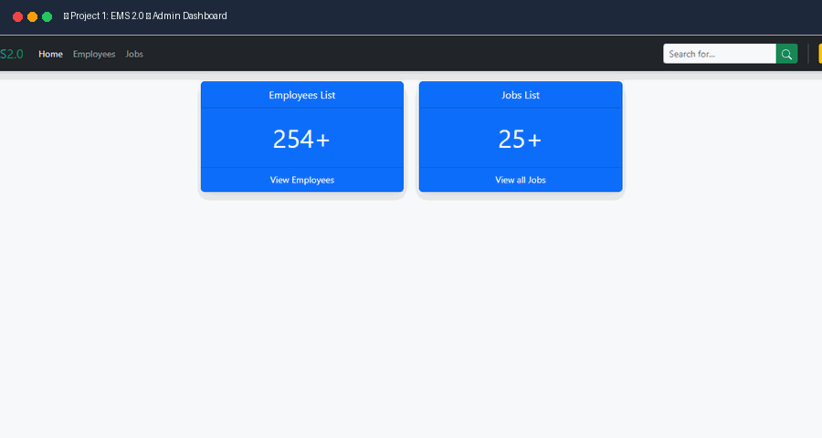

# Bootstrap 5 Learning & Project Repository


---

## 📌 Overview

This repository contains a comprehensive, hands-on learning roadmap and practical projects built with **Bootstrap 5.3**. It covers core grid layouts, content styling, interactive forms, UI components, modern helper utilities, extensive atomic utility classes, and real-world multi-page web applications.

---

## 🛠️ Tech Stack & Tools

- **HTML5**: Semantic markup structuring
- **CSS3**: Custom gradients, glassmorphism backdrop filters, variables, and scoped overrides
- **Bootstrap 5.3**: Responsive grid, utilities, layout components, and JS modules
- **JavaScript**: Popper.js and Bootstrap bundle for interactive components (dropdowns, modals, collapses)

---

## 🌐 Live Demos & Deployments

| Project | Live Demo Link | Platform |
| :--- | :--- | :--- |
| **Project 1: EMS 2.0 (Employee Management System)** | [](https://ems-web-kappa.vercel.app/) | Vercel |
| **Project 2: BLOG 2.0 (Modern Blog Platform)** | [](https://blog-app-jet-ten-12.vercel.app/) | Vercel |
| **Project 3: RW Education (Prime Inspire E-Learning)** | [](https://rw-education.vercel.app/) | Vercel |

---

## 🖼️ Featured Projects Slider

<div align="center">
  <a href="https://rw-education.vercel.app/" target="_blank">
    
  </a>
  <p><em>✨ Animated showcase of <strong>EMS 2.0</strong>, <strong>BLOG 2.0</strong>, and <strong>RW Education</strong> project interfaces</em></p>
</div>

---

## 📂 Folder Structure

```text
Bootstrap/
├── assets/
│   └── project-slider.gif    # Animated Project Showcase Slider
├── Section1 Bootstrap/
│   └── 01-hello-world/
│       └── index.html
├── Section2 Layout/
│   ├── 01-container/
│   ├── 02-grid-options/
│   ├── 03-nested-rows/
│   ├── 04-column-vertical/
│   ├── 05-column-horizontal/
│   ├── 06-column-wrap/
│   ├── 07-recording-offset/
│   ├── 08-margin-utilities/
│   ├── 09-gutters/
│   └── 10-horizontal-gutter/
├── Section3 Contents/
│   ├── 01-typography/
│   ├── 02-inline-text-elm/
│   ├── 03-blockquotes/
│   ├── 04-lists/
│   ├── 05-images-in-bootstrap/
│   ├── 06-tables-in-bootstrap/
│   ├── 07-table-alignment-nesting/
│   └── 08-figures-in-bootstrap/
├── Section4 Forms/
│   ├── 01-forms/
│   ├── 02-form-control/
│   ├── 03-checks-radios/
│   ├── 04-range/
│   ├── 05-input-groups/
│   ├── 06-floating-labels/
│   ├── 07-form-layout/
│   ├── 08-horizontal-forms/
│   ├── 09-auto-sizing-forms/
│   ├── 10-inline-forms/
│   └── 11-form-validation/
├── Section5 Components/
│   ├── 01/ to 05/            # Accordions, Alerts, Badges, Breadcrumbs
│   ├── 06/                   # Buttons & Button Grids (index.html, button.html)
│   ├── 07/ to 09/            # Button Groups, Toolbars, Sizing
│   └── 10/ to 26/            # Component Practice Modules
├── Section6 Helpers Bootstrap/
│   ├── 01-clearfix/
│   ├── 02-colors-bg/
│   ├── 03-colored-links/
│   ├── 04-link-util/
│   ├── 05-focus-ring/
│   ├── 06-icon-link/
│   ├── 07-ratio/
│   ├── 08-positions/
│   ├── 09-stacks/
│   ├── 10-visually-hidden/
│   ├── 11-streched-link/
│   └── 12-text-truncate/
├── Section7 Utilities/
│   ├── 01-backgrounds/ to 04-bg-opacity/
│   ├── 05-border/ to 10-rounded-border/
│   ├── 11-text-color/ & 12-text-opacity/
│   ├── 13-display-inline/ to 15-display-in-print/
│   ├── 16-flex/ to 28-flex-media-object/
│   ├── 29-responsive-float/ & 30-interactions/
│   ├── 31-link-opacity/ to 33-color-links/
│   ├── 34-object-fit/ & 35-object-fit-responsive/
│   ├── 36-opacity/ & 37-overflow/
│   ├── 38-postion/ to 42-pos-exm-two/
│   ├── 43-shadow/
│   ├── 44-sizing/ & 45-gap/
│   ├── 46-text-align/ to 55-text-decoration/
│   ├── 56-vertical-alignment/
│   ├── 57-visibility/
│   └── 58-z-index/
├── Section8 Project One/
│   ├── ReadmeImages/         # Project 1 Preview Screenshots
│   │   ├── emsLogIn.png
│   │   ├── emsMain.png
│   │   ├── emsEmp.png
│   │   └── emsJob.png
│   ├── index.html            # Authentication / Login Page
│   ├── dash.html             # Main EMS Admin Dashboard
│   ├── employees-list.html   # Employee Directory with Modals & Table
│   └── jobs-list.html        # Job Management Directory
├── Section9 Project Two/
│   ├── img/
│   │   ├── Banner.jpg        # Hero Header Banner Image
│   │   └── post-image.jpg    # Featured Post Thumbnail Image
│   ├── ReadmeImages/         # Project 2 Preview Screenshots
│   │   ├── Main Page.png
│   │   ├── post.png
│   │   └── categories.png
│   ├── default.html          # Default Layout Template
│   ├── index.html            # Blog Homepage with Hero Banner & Posts Grid
│   ├── page.html             # Single Static Page Template
│   ├── posts.html            # Single Article Details & Comments Section
│   ├── search.html           # Search Results & Filter Page
│   └── style.css             # Custom Styles & Glassmorphism Navigation
└── Section10 Project Three/
    ├── img/                  # Logo, Icons & Illustration Media Assets
    │   ├── Prime-Inspire-Logo.svg
    │   ├── main-header.jpg
    │   └── subscribe.jpg
    ├── ReadmeImages/         # Project 3 Preview Screenshots
    │   ├── home.png
    │   ├── courses.png
    │   ├── single-course.png
    │   ├── blog.png
    │   ├── contact.png
    │   └── single-post.png
    ├── about.html            # About the Platform Page
    ├── blog.html             # Education Blog & Articles
    ├── contact.html          # Contact Inquiry Page & Office Info
    ├── courses.html          # Course Catalog & Filters
    ├── faq.html              # Frequently Asked Questions Accordion
    ├── index.html            # Prime Inspire E-Learning Homepage
    ├── single-course.html    # Detailed Course Syllabus & Enrollment
    ├── single-post.html      # Individual Blog Post Reader Page
    └── styles.css            # Custom Styling & Glassmorphism Blur
```

---

## 📖 Sections Breakdown

### 📚 [Section 1: Bootstrap Setup & Basics](Section1%20Bootstrap/README.md)
- **01-hello-world**: Bootstrap 5 setup via CDN (`bootstrap.min.css` & `bootstrap.bundle.min.js`), viewport meta configuration, and starter boilerplate testing.

---

### 📐 [Section 2: Layout & Grid System](Section2%20Layout/README.md)
Deep dive into Bootstrap's 12-column responsive grid engine and containers:
- **Containers**: Responsive fixed `.container` vs fluid `.container-fluid`.
- **Grid Options**: Responsive column scaling (`col-sm`, `col-md`, `col-lg`, `col-xl`).
- **Nested Rows**: Nesting rows inside existing columns for complex layouts.
- **Alignment Utilities**: Vertical alignment (`align-items-*`) and horizontal justification (`justify-content-*`).
- **Column Wrapping & Offsets**: Multi-row wrapping, column offset classes (`offset-md-*`), and visual reordering (`order-*`).
- **Margin Auto Utilities**: Flex-based spacing inside grid rows (`ms-auto`, `me-auto`).
- **Gutters**: Controlling horizontal (`gx-*`), vertical (`gy-*`), and unified (`g-*`) spacing between columns.

---

### ✍️ [Section 3: Contents & Typography](Section3%20Contents/README.md)
Styling foundational typography and HTML content elements:
- **Typography & Inline Elements**: Display headings (`display-1` to `display-6`), lead text (`.lead`), mark, text strike, small, and bold text.
- **Blockquotes**: Quotations styling and cite footers (`.blockquote-footer`).
- **Lists**: Unstyled lists (`.list-unstyled`) and inline list items (`.list-inline`).
- **Images & Figures**: Fluid responsive images (`.img-fluid`), thumbnails (`.img-thumbnail`), and figure captions.
- **Tables**: Striped, bordered, borderless, dark, hoverable tables, and vertically aligned table cells (`.align-middle`).

---

### 📝 [Section 4: Forms & Input Controls](Section4%20Forms/README.md)
Modern, accessible, and responsive form components:
- **Form Controls & Sizing**: Standard input controls, sizing (`.form-control-lg`, `.form-control-sm`), and disabled/readonly states.
- **Checks, Radios & Switches**: Custom styled checkboxes, radio buttons, and toggle switches (`.form-switch`).
- **Range & Input Groups**: Range sliders and prepend/append input addons (`.input-group-text`).
- **Floating Labels**: Animated floating placeholder labels (`.form-floating`).
- **Form Layouts**: Horizontal forms, auto-sizing columns, inline forms, and responsive form grids.
- **Form Validation**: Native HTML5 and custom client-side validation states (`.was-validated`, `.is-valid`, `.is-invalid`, `.valid-feedback`, `.invalid-feedback`).

---

### 🧩 [Section 5: Components](Section5%20Components/README.md)
Interactive, reusable Bootstrap UI components:
- **Accordions (`01`)**: Collapsible accordion panels (`.accordion`, `.accordion-item`, `.accordion-button`).
- **Alerts & Links (`02`)**: Contextual alert boxes (`.alert-*`) with styled inline hyperlinks (`.alert-link`).
- **Dismissible Alerts (`03`)**: Interactive dismissible alerts with smooth fade transitions (`.alert-dismissible`, `.btn-close`).
- **Badges (`04`)**: Notification counters, contextual badges, and pill tags (`.badge`, `.rounded-pill`).
- **Breadcrumbs (`05`)**: Navigation trail indicators for page hierarchy (`.breadcrumb`, `.breadcrumb-item`).
- **Buttons & Grids (`06`)**: Contextual and outline buttons (`.btn-*`, `.btn-outline-*`), size variants (`.btn-lg`, `.btn-sm`), and full-width block buttons via grid wrappers (`d-grid gap-2`).
- **Button Groups & Toolbars (`07`, `08`)**: Grouping buttons together (`.btn-group`), combining multiple button groups with input groups into unified toolbars (`.btn-toolbar`).
- **Button Sizing & Orientation (`09`)**: Large/small button groups and vertical stacking (`.btn-group-vertical`).
- **Practice Modules (`10` to `26`)**: Component hands-on practice modules.

---

### 🛠️ [Section 6: Helpers Bootstrap](Section6%20Helpers%20Bootstrap/README.md)
Specialized helper classes that streamline common UI tasks:
- **Clearfix**: Clearing floated elements with `.clearfix`.
- **Color & Background Helpers**: Text and background color styling helper utilities.
- **Colored Links & Link Utilities**: Underline styling, link offset, and hover states (`.link-offset-*`, `.link-underline-*`).
- **Focus Ring & Icon Link**: Accessible focus outlines and animated icon links.
- **Ratio**: Responsive 16:9, 4:3, and 1:1 aspect ratio containers for videos and iframes (`.ratio`).
- **Position Helpers**: Sticky (`.sticky-top`) and fixed (`.fixed-top`, `.fixed-bottom`) elements.
- **Stacks**: Vertical (`.vstack`) and horizontal (`.hstack`) flex stack wrappers.
- **Visually Hidden**: Screen reader-only utility (`.visually-hidden`).
- **Stretched Link**: Making an entire card or containing block clickable (`.stretched-link`).
- **Text Truncation**: Single-line text ellipsis helper (`.text-truncate`).

---

### ⚡ [Section 7: Utilities](Section7%20Utilities/README.md)
Comprehensive reference of Bootstrap 5 atomic utility classes:
- **Backgrounds & Borders**: Color palettes, gradients, opacity control, border widths, colors, and rounded corners (`rounded-pill`, `rounded-circle`).
- **Colors & Opacity**: Contextual text colors and text opacity utilities.
- **Display & Visibility**: Display modes (`d-none`, `d-block`, `d-flex`, `d-print-none`), visibility toggling.
- **Flexbox Mastery**: Complete flex utilities including direction (`flex-row`, `flex-column`), justify content, align items, self alignment, flex fill, grow/shrink, auto-margins, wrapping, order, and media objects.
- **Object Fit & Overflow**: Object-fit responsive controls (`object-fit-cover`, `object-fit-contain`), overflow clipping and scrollbars.
- **Positioning**: Absolute/relative positions, centering utilities (`translate-middle`), coordinate offsets (`top-0`, `start-50`, etc.), and z-index layers.
- **Spacing & Sizing**: Width/height percentage classes (`w-100`, `h-100`, `mw-100`), auto margins, and gap utilities.
- **Typography Utilities**: Text alignment, wrapping, line breaks, text transform (uppercase, lowercase, capitalize), font weights, italics, line height, and monospace fonts.

---

### 🚀 [Section 8: Project One - EMS 2.0 (Employee Management System)](Section8%20Project%20One/README.md)

[](https://ems-web-kappa.vercel.app/)

A complete, responsive multi-page administrative web application built using Bootstrap 5:
- **`index.html` (Authentication)**: Clean login page featuring floating labels, remember-me checkbox, gradient text branding, and shadow cards.
- **`dash.html` (Dashboard)**: Central operations dashboard equipped with:
  - Dark responsive top navigation bar with collapse toggle and profile dropdown.
  - Key performance metric cards (Employees count, Open Jobs, Pending Applications).
  - Quick action buttons and recent activities list.
- **`employees-list.html` (Employee Directory)**:
  - Tabular list of registered employees with status badges.
  - Interactive "Add Employee" modal with structured form inputs.
  - Action buttons for editing, viewing, and deleting employee records.
  - Responsive pagination controls.
- **`jobs-list.html` (Job Postings Management)**:
  - Active job positions overview table with department tags and application counts.
  - "Add Job" modal form for posting new openings.
  - Filterable layout and management actions.

#### 📸 Project 1 Interface & Screenshots

| 🔐 Login Authentication | 📊 Admin Operations Dashboard |
| :---: | :---: |
| [](https://ems-web-kappa.vercel.app/) | [](https://ems-web-kappa.vercel.app/) |

| 👥 Employee Directory & Modal Form | 💼 Job Postings & Hiring Directory |
| :---: | :---: |
| [](https://ems-web-kappa.vercel.app/) | [](https://ems-web-kappa.vercel.app/) |

---

### 📰 [Section 9: Project Two - BLOG 2.0 (Modern Responsive Blog Platform)](Section9%20Project%20Two/README.md)

[](https://blog-app-jet-ten-12.vercel.app/)

A full-featured, responsive multi-page modern blog platform:
- **`index.html` (Homepage)**:
  - Fixed-top frosted glass navbar with search bar and mobile toggle (`custom-nav` with backdrop blur).
  - Hero banner with custom gradient branding (`BLOG2.0`).
  - Featured article feed with category tags, author metadata, read-more links, and pagination.
  - Interactive newsletter subscription modal trigger.
  - Sidebar with author profile card, category pills, tags, and search widget.
- **`posts.html` (Single Post)**:
  - Formatted article view with full headers, typography hierarchy, blockquotes, and featured post media.
  - Author bio box with avatar and profile summary.
  - Comment submission form with real-time responsive discussion threads.
- **`page.html` (Static Page)**:
  - Clean generic page template suited for static content (About Us, Privacy Policy, Terms).
- **`search.html` (Search Results)**:
  - Search query header with matching post card results, sidebar filters, and pagination.
- **`default.html` (Default Layout Template)**:
  - Base blueprint combining navigation, hero header, loop area, sidebar, and multi-column footer.
- **`style.css`**:
  - Custom CSS styling featuring multi-stop gradient branding (`.brand-gradient`), responsive cover banner (`.banner-holder`), and glassmorphism navbar (`.custom-nav`).
- **`img/`**:
  - Project image assets (`Banner.jpg`, `post-image.jpg`).

#### 📸 Project 2 Interface & Screenshots

| 📰 Blog Homepage & Hero Banner | 📖 Single Article & Comments | 🔍 Categories & Search Archive |
| :---: | :---: | :---: |
| [](https://blog-app-jet-ten-12.vercel.app/) | [](https://blog-app-jet-ten-12.vercel.app/) | [](https://blog-app-jet-ten-12.vercel.app/) |

---

### 🎓 [Section 10: Project Three - RW Education (Prime Inspire E-Learning Platform)](Section10%20Project%20Three/README.md)

[](https://rw-education.vercel.app/)

A complete, modern multi-page online education and learning platform built with Bootstrap 5:
- **`index.html` (Homepage)**:
  - Sticky glassmorphism header with navigation, brand logo (`Prime-Inspire-Logo.svg`), and auth triggers.
  - Interactive hero section with instant course search bar and statistics badges.
  - Top category cards with course counters and hover micro-animations.
  - Featured course grid with pricing, instructor info, duration badges, and rating stars.
  - Testimonials slider, trust badges, and newsletter subscription banner.
- **`courses.html` (Course Catalog)**:
  - Searchable and filterable course library with multi-criteria accordion filters (categories, level, pricing).
  - Responsive course cards with metadata tags, instructor attribution, and quick enroll actions.
- **`single-course.html` (Course Details & Syllabus)**:
  - Video preview placeholder, comprehensive course curriculum accordion modules, and learning outcomes checklist.
  - Instructor profile bio card and sticky enrollment pricing summary box.
- **`about.html` (About Us)**:
  - Mission & vision statement, platform achievements counter, and leadership faculty directory.
- **`blog.html` (Education Insights)**:
  - Educational articles, tutorials, and career guidance posts grid with category badges and pagination.
- **`single-post.html` (Article Reading Experience)**:
  - Full article layout with hero header banner, rich typography, author credentials, related articles, and comments.
- **`contact.html` (Contact & Support)**:
  - Contact form, interactive location card, office inquiry channels, modal trigger, and responsive footer.
- **`faq.html` (FAQ & Support)**:
  - Expandable Bootstrap accordions answering student, teacher, and billing queries.
- **`styles.css`**:
  - Scoped custom stylesheet for brand colors, blurred navigation backdrop filter, and smooth hover effects.
- **`img/`**:
  - Media assets including SVG logos, responsive illustrations, and course banners.

#### 📸 Project 3 Interface & Screenshots

| 🎓 E-Learning Homepage | 📚 Course Catalog & Filters | 📝 Single Course Syllabus |
| :---: | :---: | :---: |
| [](https://rw-education.vercel.app/) | [](https://rw-education.vercel.app/) | [](https://rw-education.vercel.app/) |

| 📰 Education Blog & Articles | 📖 Single Article Reader | 📬 Contact & Support Page |
| :---: | :---: | :---: |
| [](https://rw-education.vercel.app/) | [](https://rw-education.vercel.app/) | [](https://rw-education.vercel.app/) |

---

## 🚀 How to Run & Preview

1. **Clone or Download** the repository to your local machine:
   ```bash
   git clone https://github.com/your-username/Bootstrap.git
   ```
2. **Open in VS Code**:
   ```bash
   code .
   ```
3. **Launch in Browser**:
   - Right-click any `.html` file (e.g., `Section9 Project Two/index.html` or `Section8 Project One/dash.html`) and select **Open with Live Server**, or double-click the file in File Explorer to open it in your default web browser.
