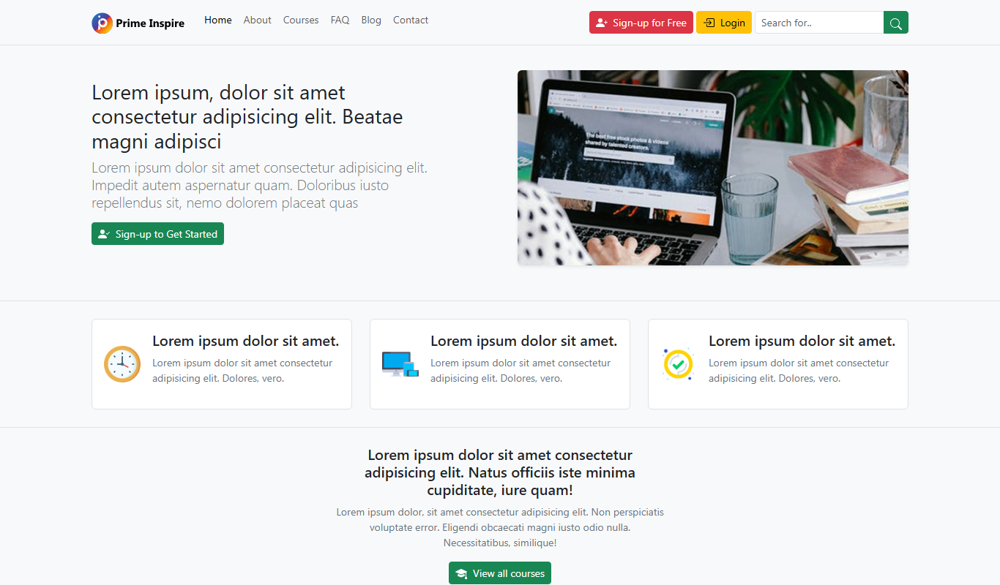
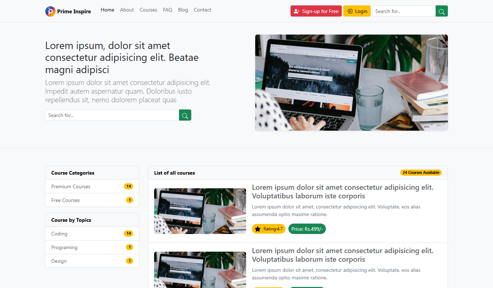
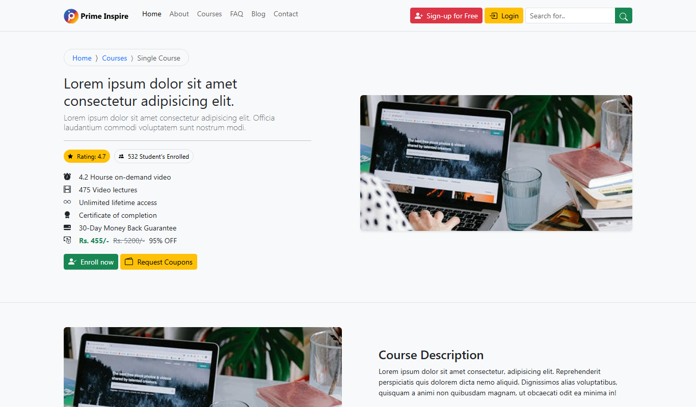
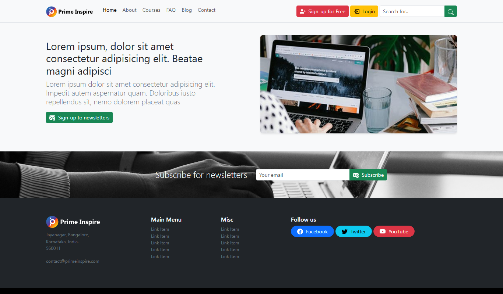
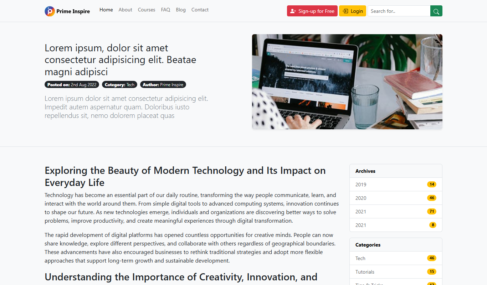
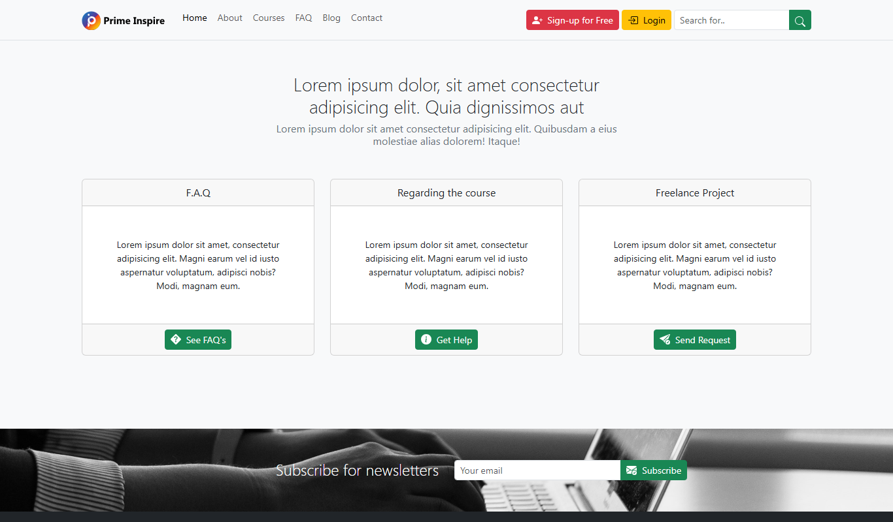

# Section 10: Project Three — RW Education (Prime Inspire E-Learning)


[⬅ Back to Main README](../README.md)

---

## 🌐 Live Demo

[](https://rw-education.vercel.app/)

**Live URL**: [https://rw-education.vercel.app/](https://rw-education.vercel.app/)

---

## 📌 Overview

**RW Education (Prime Inspire)** is a multi-page e-learning web platform built with **Bootstrap 5.3**. It provides course discovery, detailed curriculum syllabi, instructor profiles, educational blogs, support FAQs, and interactive contact forms.

---

## 📸 Screenshots & Interface Previews

| 🎓 E-Learning Homepage | 📚 Course Catalog & Filters | 📝 Single Course Syllabus |
| :---: | :---: | :---: |
| [](https://rw-education.vercel.app/) | [](https://rw-education.vercel.app/) | [](https://rw-education.vercel.app/) |

| 📰 Education Blog & Articles | 📖 Single Article Reader | 📬 Contact & Support Page |
| :---: | :---: | :---: |
| [](https://rw-education.vercel.app/) | [](https://rw-education.vercel.app/) | [](https://rw-education.vercel.app/) |

---

## 📂 Directory Structure

```text
Section10 Project Three/
├── img/
│   ├── clock.png             # Duration & Timing Badge Icon
│   ├── main-header.jpg       # Hero Section Background Graphic
│   ├── Prime-Inspire-Logo.svg# Primary Light Brand SVG Logo
│   ├── Prime-Inspire-Logo-dark.svg # Dark Brand SVG Logo
│   ├── responsive.png        # Feature Illustration Asset
│   ├── subscribe.jpg         # Newsletter Banner Background
│   └── tick.png              # Learning Outcome Checkmark Icon
├── ReadmeImages/
│   ├── home.png              # E-Learning Homepage Screenshot
│   ├── courses.png           # Course Catalog & Filters Screenshot
│   ├── single-course.png     # Course Details & Syllabus Screenshot
│   ├── blog.png              # Blog Articles Archive Screenshot
│   ├── contact.png           # Contact & Office Support Screenshot
│   └── single-post.png       # Article Reader Screenshot
├── about.html                # Platform Story, Mission & Faculty Directory
├── blog.html                 # Educational Insights, Tutorials & Guides
├── contact.html              # Contact Form, Map Info & Inquiry Modal
├── courses.html              # Searchable Course Catalog & Filter Sidebar
├── faq.html                  # Accordion-Powered Questions & Answers
├── index.html                # Prime Inspire E-Learning Main Homepage
├── single-course.html        # Detailed Course Syllabus & Sticky Enrollment
├── single-post.html          # Individual Article View with Discussions
└── styles.css                # Custom Palette, Blur Nav & Hover Effects
```

---

## 📖 Page Architecture & Features

### 1. `index.html` — Homepage
- Sticky navbar with blur backdrop filter (`.blur-filter`) and mobile navigation toggle.
- Hero section with search courses input, stats counters, and platform highlights.
- Top category cards with course counters and micro-interaction hover animations.
- Featured course cards featuring star ratings, prices, instructor names, and duration badges.
- Student testimonial carousel, trust badges, and newsletter subscription CTA.

### 2. `courses.html` — Course Catalog
- Search input and sorting controls (Popular, Price, Rating).
- Multi-criteria accordion filters in sidebar (Categories, Difficulty Level, Price).
- Responsive course grid layout with pagination controls.

### 3. `single-course.html` — Course Details
- Course overview header with breadcrumbs and video preview placeholder.
- Multi-module curriculum accordion (`.accordion`) detailing lectures and syllabus.
- Key learning outcomes checklist with custom tick icons.
- Instructor biography card and sticky pricing/enrollment widget.

### 4. `about.html` — About Us
- Mission, vision, and core educational values.
- Achievement counter cards and leadership faculty team profiles.

### 5. `blog.html` & `single-post.html` — Education Blog
- Educational article listings with category badges, author tags, and reading times.
- Dedicated article page (`single-post.html`) with rich typography, author credentials, and discussion threads.

### 6. `contact.html` — Contact & Support
- Interactive contact inquiry form with validation styling.
- Office location info card, working hours, and email channels.
- Contact modal for quick messages and mobile sticky footer navigation.

### 7. `faq.html` — Frequently Asked Questions
- Categorized Bootstrap accordions providing answers for prospective students and instructors.

---

## 🚀 How to Run Locally

1. Open `Section10 Project Three` in VS Code.
2. Right-click `index.html` and choose **Open with Live Server**.
3. Explore the course catalog, single course pages, blog, and contact forms.

