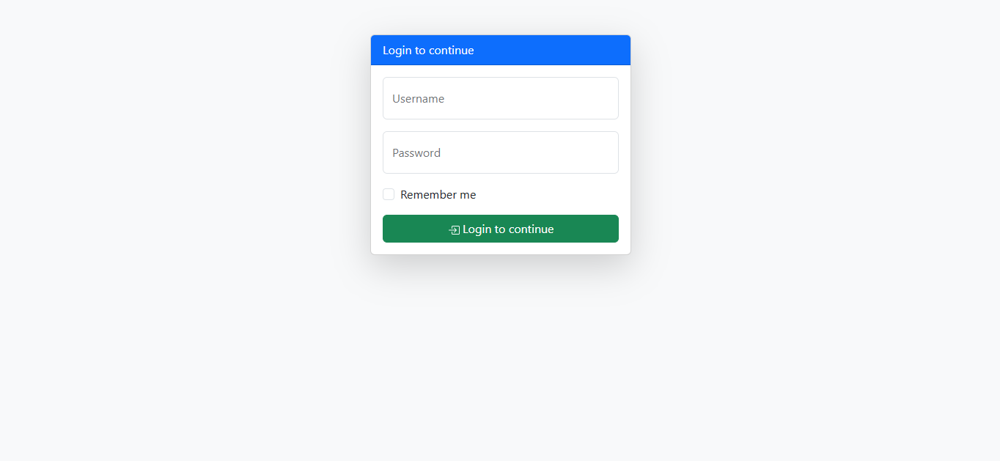
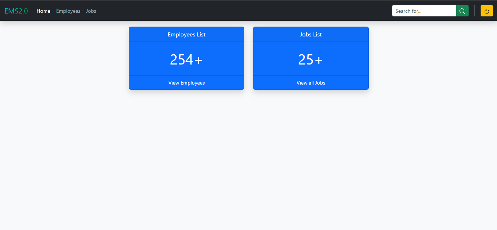
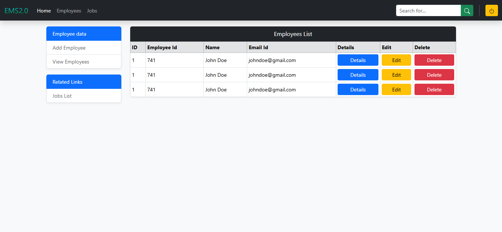
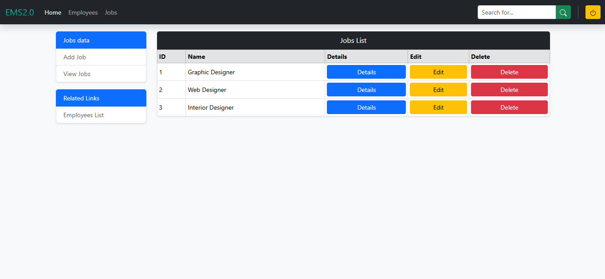

# Section 8: Project One — EMS 2.0 (Employee Management System)


[⬅ Back to Main README](../README.md)

---

## 🌐 Live Demo

[](https://ems-web-kappa.vercel.app/)

**Live URL**: [https://ems-web-kappa.vercel.app/](https://ems-web-kappa.vercel.app/)

---

## 📌 Overview

**EMS 2.0** is a full-featured, responsive administrative web application built with **Bootstrap 5.3**. It simulates an enterprise employee and job management dashboard with authentication, analytics cards, employee directories, and vacancy management.

---

## 📸 Screenshots & Interface Previews

| 🔐 Login Authentication | 📊 Admin Operations Dashboard |
| :---: | :---: |
| [](https://ems-web-kappa.vercel.app/) | [](https://ems-web-kappa.vercel.app/) |

| 👥 Employee Directory & Modal Form | 💼 Job Postings & Hiring Directory |
| :---: | :---: |
| [](https://ems-web-kappa.vercel.app/) | [](https://ems-web-kappa.vercel.app/) |

---

## 📂 Directory Structure

```text
Section8 Project One/
├── ReadmeImages/
│   ├── emsLogIn.png          # Login Screen Preview
│   ├── emsMain.png           # Dashboard Preview
│   ├── emsEmp.png            # Employees Table & Modal Preview
│   └── emsJob.png            # Jobs Directory Preview
├── index.html                # Authentication Login Page
├── dash.html                 # Central Admin Dashboard
├── employees-list.html       # Employee Directory Table & Modal
└── jobs-list.html            # Job Openings Directory
```

---

## 📖 Page Architecture & Features

### 1. `index.html` — Authentication Page
- Centered card layout using grid utilities (`row justify-content-center`, `col-md-4`).
- Floating input fields (`.form-floating`) for username and password.
- "Remember Me" checkbox with custom styling.
- Linear gradient brand header (`.brand-gradient`).
- Shadow styling with `.shadow-lg`.

### 2. `dash.html` — Operations Dashboard
- Dark fixed navbar with branding, mobile toggle collapse, and avatar dropdown.
- Performance metric cards displaying active employee counts, open positions, and applicants.
- Quick action buttons (Add Employee, Post Job).
- Recent activity data table.

### 3. `employees-list.html` — Employee Directory
- Filterable and responsive data table with striped rows (`.table-striped`, `.table-hover`).
- Contextual badge indicators for employment status (Active, On Leave, Remote).
- Interactive Bootstrap Modal (`#add_employee`) with structured inputs for employee details.
- Edit, View, and Delete action button groups.
- Responsive pagination controls.

### 4. `jobs-list.html` — Job Vacancy Management
- Job positions directory with department tags, location badges, and applicant counters.
- "Add Job" modal form for publishing new openings.
- Responsive table layout with action buttons.

---

## 🚀 How to Run Locally

1. Open `Section8 Project One` in VS Code.
2. Right-click `index.html` and select **Open with Live Server**.
3. Log in to navigate through `dash.html`, `employees-list.html`, and `jobs-list.html`.

