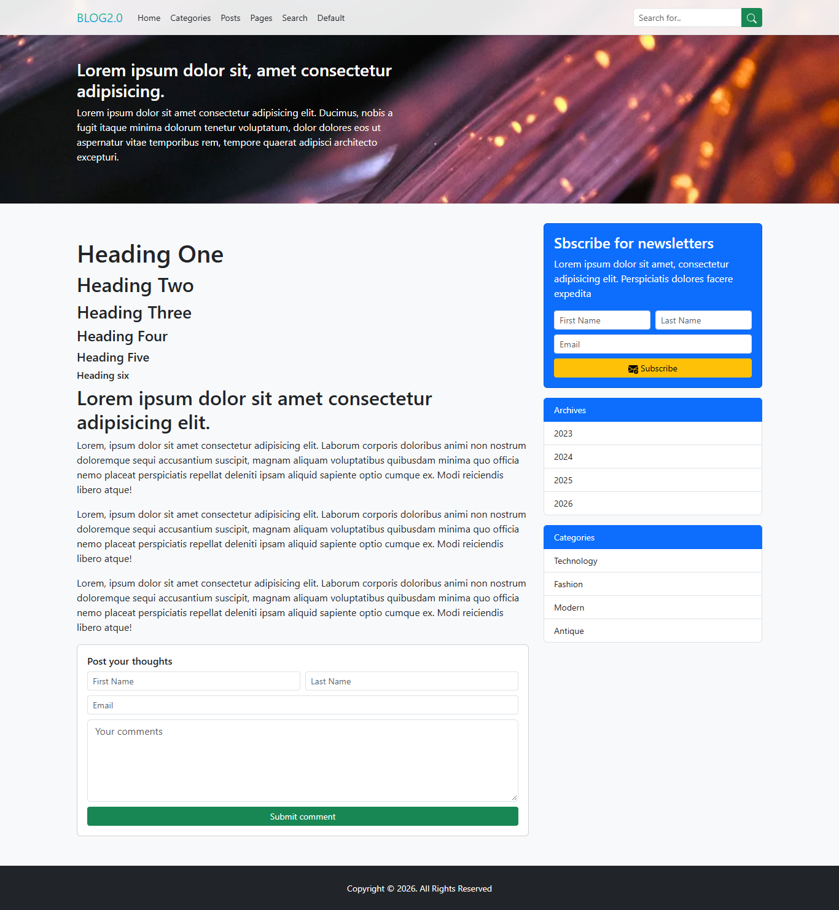
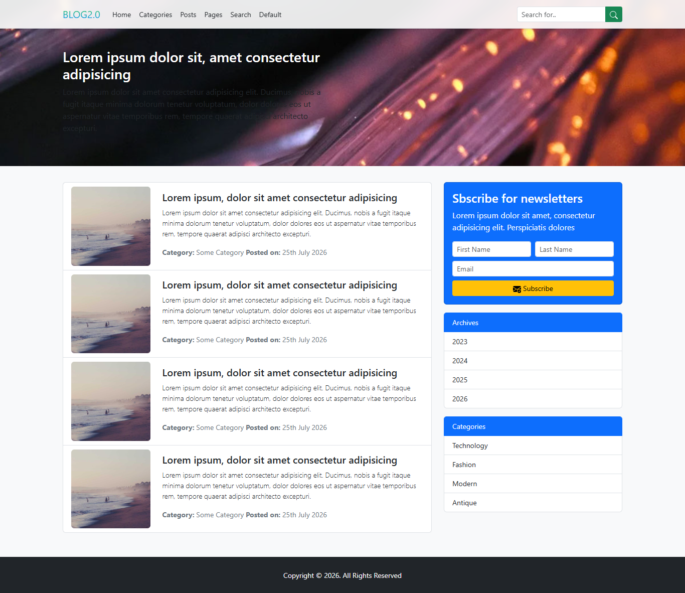

# Section 9: Project Two — BLOG 2.0 (Modern Responsive Blog Platform)


[⬅ Back to Main README](../README.md)

---

## 🌐 Live Demo

[](https://blog-app-jet-ten-12.vercel.app/)

**Live URL**: [https://blog-app-jet-ten-12.vercel.app/](https://blog-app-jet-ten-12.vercel.app/)

---

## 📌 Overview

**BLOG 2.0** is a clean, multi-page modern blogging website built with **Bootstrap 5.3**. It showcases glassmorphism navigation, hero banner styling, responsive card grids, author sidebar widgets, search filtering, and interactive discussion threads.

---

## 📸 Screenshots & Interface Previews

| 📰 Blog Homepage & Hero Banner | 📖 Single Article & Comments | 🔍 Categories & Search Archive |
| :---: | :---: | :---: |
| [](https://blog-app-jet-ten-12.vercel.app/) | [](https://blog-app-jet-ten-12.vercel.app/) | [](https://blog-app-jet-ten-12.vercel.app/) |

---

## 📂 Directory Structure

```text
Section9 Project Two/
├── img/
│   ├── Banner.jpg            # Full-Width Hero Header Background
│   └── post-image.jpg        # Featured Post Thumbnail Asset
├── ReadmeImages/
│   ├── Main Page.png         # Homepage Screenshot
│   ├── post.png              # Single Article Reader Screenshot
│   └── categories.png        # Categories & Search Results Screenshot
├── default.html              # Base Blueprint & Layout Template
├── index.html                # Blog Homepage (Hero Banner & Feed)
├── page.html                 # Generic Static Page Template
├── posts.html                # Single Post Details & Discussion
├── search.html               # Search Results Page with Query Filter
└── style.css                 # Custom CSS & Glassmorphism Blur
```

---

## 📖 Page Architecture & Features

### 1. `index.html` — Homepage
- Fixed-top frosted navbar (`.custom-nav` with `backdrop-filter: blur(8px);` and `--bs-bg-opacity: .9`).
- Hero banner section (`.banner-holder`) featuring gradient typography (`.brand-gradient`).
- Dynamic card grid showing recent articles, publication timestamps, category pills, and author tags.
- Sidebar widgets: Author bio card, category list, tag cloud, and search form.
- Newsletter subscription trigger with Bootstrap modal.
- Multi-column footer with quick links and copyright notes.

### 2. `posts.html` — Single Post View
- Article hero header with metadata (author, date, category).
- Rich body typography with blockquotes, images, and lead text.
- Author biography box with profile avatar.
- Interactive comment form and nested discussion replies.
- Sidebar featuring related articles and popular tags.

### 3. `page.html` — Static Content Page
- Clean layout template designed for static information pages such as About Us, Privacy Policy, or Terms of Service.

### 4. `search.html` — Search Results
- Dynamic search query headline displaying matched articles.
- Filterable result feed with pagination controls (`.pagination`, `.page-item`).

### 5. `default.html` — Default Template Blueprint
- Standard layout blueprint combining header, main article loop, sidebar widgets, and footer.

---

## 🚀 How to Run Locally

1. Open `Section9 Project Two` in VS Code.
2. Right-click `index.html` and choose **Open with Live Server**.
3. Navigate between pages via top navigation or card links.

